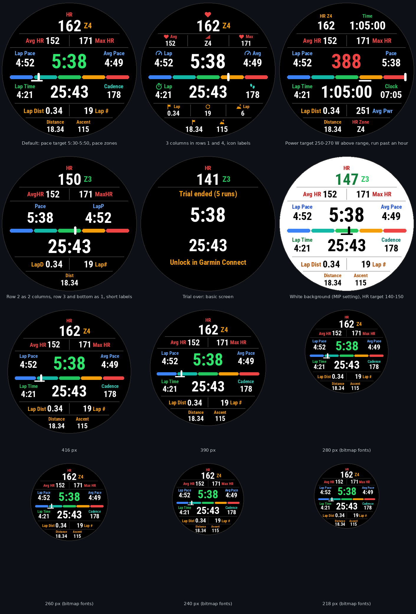

# RunDeck for Garmin — one-screen running dashboard (Connect IQ data field)

The Garmin version of [RunDeck for Amazfit](https://github.com/andrejd1/rundeck): a
**Connect IQ data field** that fills one data screen of the native Garmin running activity
with a dense, glanceable layout — HR with its zone, lap vs average pace around a big center
pace (or power), a five-zone bar, workout time, cadence, lap distance, distance and ascent —
all on one page.

The native activity keeps GPS, recording, laps and the activity file. **Every number on
the screen is the watch's own**: RunDeck reads the native activity (`Activity.Info`), the
user profile and the system, converts units the way the watch is set (km/mi, m/ft, °C/°F,
12/24 h), and draws. It smooths, estimates and averages nothing.

> **Status: never run on a watch or in the Garmin simulator.** The code type-checks
> strictly (`-l 3`) and builds for all 67 supported watches, and the layout renderer checks
> every column combination on every screen size, but the simulator needs Garmin's device
> files (a Garmin login) and wasn't available where this was written. Side-load it on a
> watch (or run the simulator) before publishing. See [Before release](#before-release).



(`python3 tools/preview.py` renders this from the same geometry and field catalog the
watch uses.)

## The screen

```
                  162 Z4
      Avg HR 152   │   171 Max HR
 Lap Pace        5:38         Avg Pace       <- center: pace or power, colored vs target
   4:52                         4:49
 ▬▬▬▬▬▬▬▮▬▬▬▬▬▬▬▬▬▬▬▬▬▬▬▬▬▬▬▬▬▬▬▬           <- zone bar: HR, pace or power zones
 Lap Time        25:43        Cadence
   4:21                         178
      Lap Dist 0.34  │  19 Lap #
        Distance 18.34  Ascent 115
```

Put RunDeck on a **one-field data screen** of the Run activity (activity settings → data
screens → layout with 1 field → Connect IQ → RunDeck). In a smaller spot of a multi-field
screen it shows one field with its label ("Field in a smaller data screen spot", pace by
default).

### Where every value comes from

| What | Source |
|---|---|
| HR, avg/max HR, pace and speed (current/avg/max), power (current/avg/max), timer, elapsed time, distance, ascent, descent, altitude, cadence (current/avg/max), calories, aerobic training effect, distance to destination | `Activity.Info`, the native activity's own values |
| HR zone (field, top-row suffix, "HR Z3" labels), zone bar marker | native heart rate placed in **the watch's own HR zones** (`UserProfile.getHeartRateZones`, by the watch's rule: zone *n* runs up to and including its max) |
| VO2 max | `UserProfile` (running VO2 max) |
| Temperature | the watch's temperature sensor, latest logged reading (`SensorHistory`) |
| Sunrise, sunset | the watch's own (`Weather.getSunrise/getSunset`, at the place of its last weather report; no GPS permission) |
| Clock, battery | `System` |
| **Lap values** (lap/last-lap time, distance, pace, speed, ascent, descent, calories; lap number) | Connect IQ exposes **no lap values**. RunDeck takes the watch's native totals at each of the **watch's own lap marks** (`onTimerLap`: lap key, auto lap; `onWorkoutStepComplete`): lap distance = distance now − distance at the lap mark, lap time likewise on the timer, lap pace = lap time / lap distance. That is the same arithmetic the watch uses for its lap record, so the numbers match it — but strictly speaking they are differences of native values, not values the watch hands over. |

### What the Amazfit version had that Garmin can't show natively

Connect IQ gives data fields fewer values than Zepp OS's `SPORT_DATA` widgets. Rather than
compute them (the Amazfit version dropped all its own computing in 0.3.0 for good reason),
RunDeck for Garmin leaves them out:

| Amazfit field | Why it's missing on Garmin |
|---|---|
| Lap / last-lap HR, cadence and power | the watch's lap averages are not exposed; RunDeck would have to average its own 1 s samples, which can differ from the lap record |
| % max HR (current/avg/lap), % HR reserve | no native value; it would be RunDeck's arithmetic |
| 3 / 10 / 30 s power, W/kg, work | not exposed to data fields |
| Grade (current/lap/avg), vertical speed, max/min altitude | not exposed; would need RunDeck's own computation from altitude and distance |
| Stride length (current/avg/lap), steps | not in `Activity.Info` (running dynamics need their own ANT connection) |
| Anaerobic TE, training load | not exposed to data fields |
| Average lap time | would be computed |
| Export/import of settings | not built (see [Not done yet](#not-done-yet)) |

New on Garmin: max HR, max cadence, best pace, elapsed time with pauses, lap calories,
distance to destination (courses), battery.

**Planned workouts:** data fields can't read the watch's workout step
(`Activity.getCurrentWorkoutStep` throws in a data field), so — as on Amazfit — the target
comes from the settings, not from the workout. Workout steps do end a lap
(`onWorkoutStepComplete`), so lap fields follow the steps.

## Customizing the screen

The screen is a top row plus five rows and the zone bar. Each row has a **column count**
(top row: 1–2, rows 1 and 4: 2–3, the big-number rows 2 and 3: 1–3, bottom row: 1–2).
Any of 45 fields can go in any spot:

- **Heart rate:** HR, HR zone, avg HR, max HR
- **Pace and speed:** pace, avg / lap / last-lap / best pace, speed, avg / lap / last-lap /
  max speed
- **Power:** power, avg power, max power
- **Time:** workout time (timer), elapsed time (with pauses), lap / last-lap time, clock,
  sunrise, sunset
- **Distance and terrain:** distance, lap / last-lap distance, lap number, distance to
  destination, ascent, descent, lap / last-lap ascent and descent, altitude
- **Running form and body:** cadence (current / avg / max), calories, lap calories,
  aerobic training effect, VO2 max, temperature, battery, or empty

HR as the single top value gets the zone suffix ("162 Z4"); HR anywhere else carries the
zone in its label ("HR Z3", zone-colored). Below zone 1 no zone is shown. Field names can
be full text, short text ("LapP") or **icons** with a qualifier ("♥ Avg"; the Amazfit
glyphs, rendered for each screen size by `tools/gen-icons.py`, since the watch doesn't
scale bitmaps). Text shrinks to fit its spot; values are sized by
their widest typical value so digits don't jump.

Two places to edit, one copy of the settings (they live on the watch):

- **Phone:** Garmin Connect app → Device → Activities & Apps → Data Fields → RunDeck →
  Settings (or Garmin Express). Groups: Screen layout, Target, Zones, Presets, License.
- **Watch:** the data field's settings in the Run activity's data screen setup → a list of
  rows (tap to step the column count) and their spots (tap to pick a field), field names,
  zone bar, the smaller-spot field, Presets.

**Presets** keep a screen layout and a target under a name (4 slots). On the watch:
settings → Presets → *Save as …* / *Apply …*. On the phone: name them under Presets, and
use the one-shot *Action* (apply preset N / save the current screen as preset N); the watch
carries it out on the next sync and sets it back to None. Zones, FTP, threshold pace and
units describe the runner, not the run, so presets leave them alone.

**Target:** pace (m:ss in the watch's pace unit), power (W) or heart rate (bpm), entered as
From / To; one end alone is a single value ± tolerance (pace ±5 s, power ±3 %, HR ±5 bpm).
Every spot showing that live value turns green inside, blue below, red above (a 3 s
average decides the color only; the number shown is always the watch's).

**Zone bar:** *Auto* (default) follows the target — power zones from FTP for a power
target, pace zones from threshold pace for a pace target, HR zones otherwise — and marks
the target range as a strip under the bar. HR / pace / power / off can be forced.

**HR zones** default to **the watch's own zones** for the current sport. % of max HR, % of
threshold HR (Friel) or custom bounds can be picked instead.

**White background:** on watches with a white data field background setting (many MIP
watches), RunDeck uses the same layout in darker inks.

**Units** are the watch's: pace and speed follow its pace/distance units, ascent and
altitude its elevation unit, temperature its temperature unit, the clock its 12/24 h
setting.

## Trial and license

- **5 free runs.** A run counts once the watch's timer passes 5 minutes, once per activity
  (known by its start time, so a data field reloaded mid-run never costs a second run).
  The run that uses up the trial finishes on the full screen.
- After that the screen drops to **basic mode** (top row, the two big values, "Unlock in
  Garmin Connect"). It never locks mid-run, and a license that arrives mid-run unlocks at
  once.
- **Unlock:** a Polar.sh license key (same organization and checkout as the Amazfit
  version, so one key works on both — see [Decisions for you](#decisions-for-you)). The
  buyer pastes it into RunDeck's settings in Garmin Connect; the next time RunDeck runs with
  the phone connected, a **background service on the watch** activates it against Polar's
  public license endpoint (no RunDeck server) through the phone's connection. Granted keys
  are re-validated weekly; offline the unlock stays. Clearing or replacing the key releases
  the activation so it can move to another watch.
- The *Status* line in the License settings group shows the trial count or the key's state
  ("Unlocked", "Key not activated: unknown key, check for typos", ...).
- Not tamper-proof: the goal is "paying is easier than cracking", not DRM.

## Supported watches

Round watches with Connect IQ 3.3+ and at least 128 KB for data fields (67 product ids in
`manifest.xml`): Forerunner 165/245 Music/255/265/570/745/945/955/965/970, fēnix 5 Plus
family, 6 Pro family, 7 family, 8 family, fēnix E, epix (Gen 2) and Pro, Enduro 2/3,
Venu 2/2 Plus/2S/3/3S, vívoactive 5/6, Instinct 3 AMOLED, MARQ (Gen 1 and 2), D2 Mach 1 /
Air X10, Descent Mk2/Mk2S/Mk3/G2.

Text is drawn in Roboto Condensed Bold at any size: the watch's own scalable font where
the firmware has scalable fonts (Connect IQ 4.2.1+, most watches from 2022 on), else bitmap
fonts generated for each screen size (`tools/gen-fonts.py`). Watches with a 32 KB data
field limit (Forerunner 245, vívoactive 4, Venu 1, fēnix 6 non-Pro, ...) and the
semi-round Instinct 2 are not supported.

## Project layout

| Path | What |
|---|---|
| `source/RunDeckField.mc` | the screen: native values, lap marks, layout, zone bar, target colors, trial gating |
| `source/RunDeckApp.mc` | app entry: the field, on-watch settings, background service, settings changes |
| `source/Config.mc` | settings → what the screen uses (zones, target, units) |
| `source/Editor.mc` | on-watch layout editor (Menu2) |
| `source/Presets.mc` | presets |
| `source/Zones.mc`, `Target.mc`, `Text.mc`, `Theme.mc`, `Fonts.mc` | zones, targets, formatting, colors, fonts |
| `source/Trial.mc`, `License.mc` | 5-run trial; Polar license (background service) |
| `source/FieldTable.mc`, `LayoutTable.mc` | **generated** by `tools/catalog.py` |
| `resources/properties.xml`, `resources/settings/settings.xml`, `resources/strings/fields.xml` | **generated** by `tools/catalog.py` |
| `resources-round-*/` | **generated** bitmap fonts (`tools/gen-fonts.py`) and field icons (`tools/gen-icons.py`) per screen size |
| `tools/catalog.py` | the field catalog, slots, defaults, every setting and the screen geometry |
| `tools/preview.py` | preview renderer + layout check (every layout, every size) |
| `tools/stub-devices.py` | stand-in device files for building without the SDK Manager (CI) |
| `tools/build.sh` | build one/all watches, package the store `.iq` |

## Develop

```
python3 tools/catalog.py          # after editing the catalog/geometry (CI checks it's in sync)
python3 tools/gen-fonts.py        # after changing font sizes (needs Pillow)
python3 tools/gen-icons.py        # after changing icons (needs cairosvg)
python3 tools/preview.py          # docs/ui-preview.png
python3 tools/preview.py --check  # every column combination on 218-454 px: nothing off-screen
                                  # or wider than its spot

# Connect IQ SDK 8.x (SDK Manager) and a developer key (see tools/build.sh)
tools/build.sh fr965              # bin/fr965/RunDeck.prg
tools/build.sh all                # every watch
tools/build.sh package            # bin/RunDeck.iq for the store
```

Simulator: `connectiq &` then `monkeydo bin/fr965/RunDeck.prg fr965`, choose the Run
activity data screen with 1 field, and play a FIT file (Simulation → FIT Data) to see laps
and values move.

Without a Garmin login (CI, sandboxes): `python3 tools/stub-devices.py <sdk> manifest.xml`
writes stand-in `compiler.json` device files from the SDK's own device reference. Enough to
type-check and build; not for the simulator or the store build. `.github/workflows/build.yml`
does this on every push.

## Before release

1. **Run it.** Simulator first (layout on fr965, fenix7, fr255, venu2; a FIT playback with
   laps; the on-watch settings; white background), then side-load on a watch for a real run.
   Things nothing here could verify: real text metrics of the watch fonts, `onTimerLap` with
   auto lap and workout steps, the background license activation over the phone, memory on
   128 KB watches (fenix 6 Pro, FR945, fēnix 8 47 mm AMOLED).
2. **Real device files** for the store build (SDK Manager), not the stand-ins.
3. **Store listing:** disclose "free for 5 runs, then a one-time license" (Garmin's review
   guidelines require it) and link the privacy statement.
4. Generate and keep a store signing key (the store only accepts updates signed with it).

## Decisions for you

- **Polar vs Garmin's own payments.** Garmin now sells apps itself (Connect IQ
  monetization: $100/year program fee, 15 % cut, Garmin handles tax and refunds, purchase in
  the Connect IQ store, offered on the newer watches only). That would remove the license
  key, the background service and the Communications permission, but also the trial. RunDeck
  is built the Amazfit way (5 free runs, Polar key) because that's what was asked; switching
  is mostly deleting `License.mc` / `Trial.mc`.
- **One key for both platforms?** The Polar organization id and checkout link are the
  Amazfit ones, so an Amazfit key unlocks Garmin too (and uses one of its 3 activations). For
  a separate Garmin product, create one at Polar and set `License.BUY_URL`.
- **Lap HR / cadence / power:** possible only as RunDeck's own average of 1 s samples.
  Left out to keep "every number is the watch's own"; easy to add behind a clear label if
  you'd rather have them.

## Not done yet

- Export / import of settings — Garmin Connect's settings page can't show a copyable code;
  presets cover switching between run types.
- A landing page (the Amazfit repo's `site/`).
